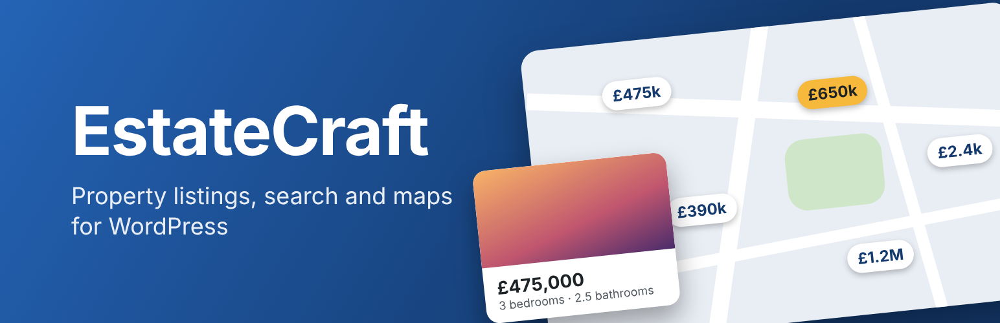
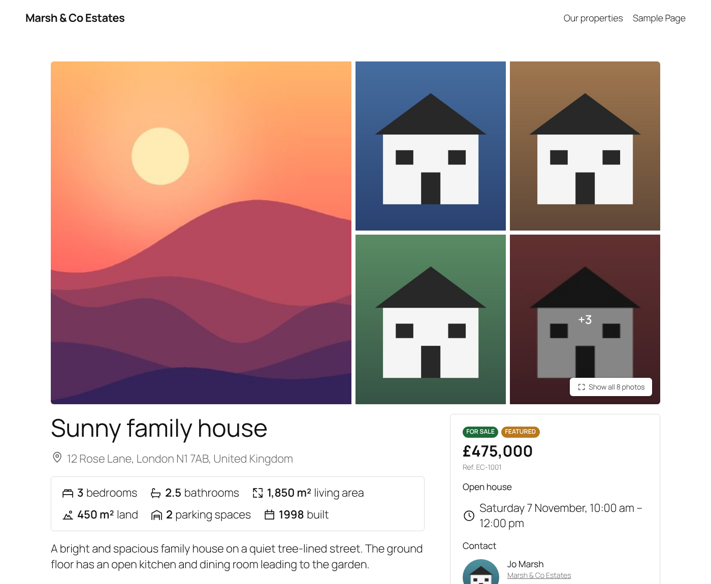
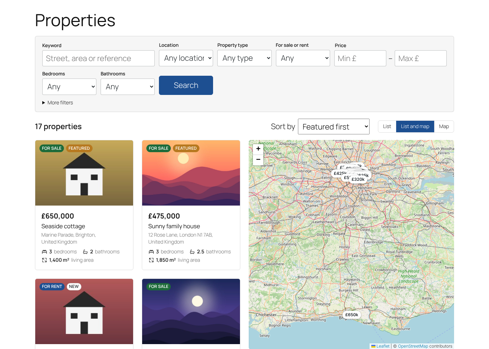
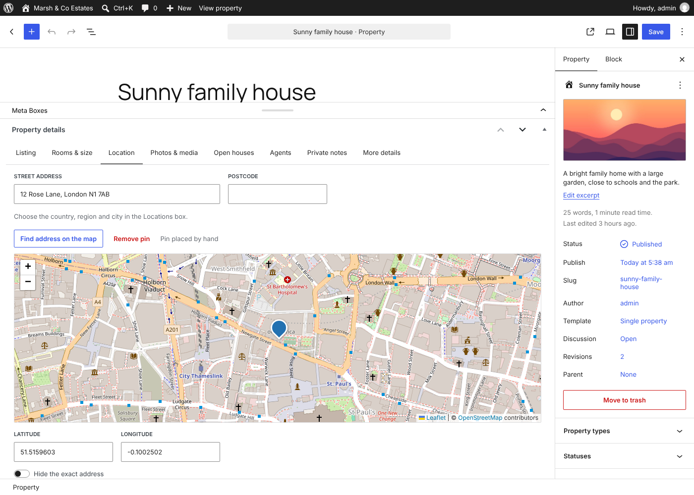
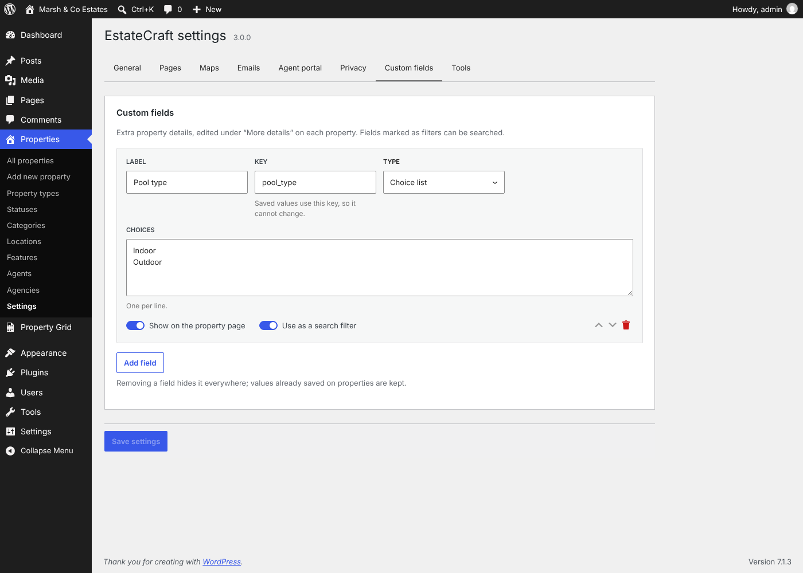
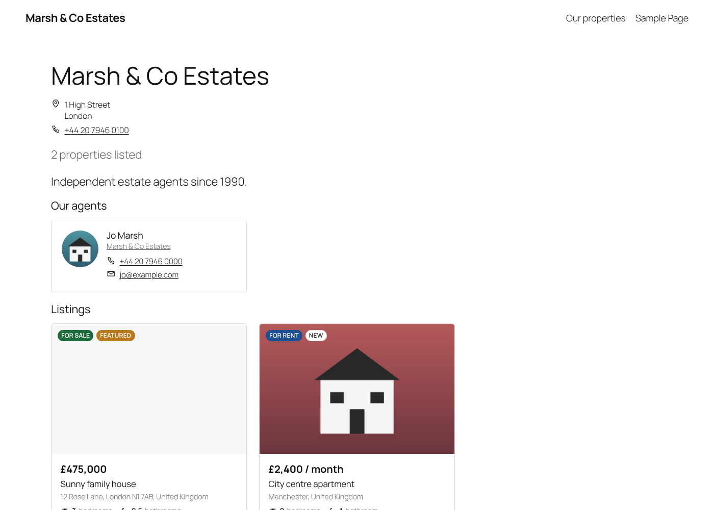

<p align="center">
  <a href="https://wordpress.org/plugins/wp-smart-property/"></a>
</p>

<h1>
  
  EstateCraft – Real Estate Listings &amp; Portal
</h1>

[](https://wordpress.org/plugins/wp-smart-property/)
[](https://wordpress.org/plugins/wp-smart-property/)
[](https://wordpress.org/plugins/wp-smart-property/)
[](https://wordpress.org/plugins/wp-smart-property/)
[](https://github.com/rajanvijayan/wp-smart-property/actions/workflows/ci.yml)
[](https://www.gnu.org/licenses/gpl-2.0.html)

Property listings for WordPress, with search, OpenStreetMap maps, agents and agencies, for block and classic themes. EstateCraft is the new name and rewrite of **WP Smart Property**: the plugin slug is still `wp-smart-property`, and existing properties move over automatically. Everything is free.

**[Download on WordPress.org](https://wordpress.org/plugins/wp-smart-property/)** · [Changelog](readme.txt) · [Roadmap](https://github.com/rajanvijayan/wp-smart-property/blob/plan/3.0/docs/ROADMAP-3.0.md)

## Screenshots

| Property page | Search with map |
|---|---|
| [](.wordpress-org/screenshot-1.png) | [](.wordpress-org/screenshot-2.png) |
| **Property details editor** | **Settings and custom fields** |
| [](.wordpress-org/screenshot-3.png) | [](.wordpress-org/screenshot-4.png) |
| **Agency page** | |
| [](.wordpress-org/screenshot-5.png) | |

## Features

### 🏠 Property details
- Price with rental period ("£1,200 / month") or "price on request", in your currency and number format.
- Bedrooms, bathrooms (halves allowed), parking, living and land area in sq ft or m², year built, energy class and your own reference number.
- Address with a map pin: drag it on an OpenStreetMap map, or let EstateCraft find it from the address. "Hide the exact address" shows visitors only the area.
- Gallery, floor plans, video and virtual tour links, open house times and private notes.
- **Custom fields builder:** text, number, choice list, yes/no and date fields, shown on property pages and usable as search filters.
- Property types, statuses (for sale, for rent, sold, rented), categories, locations (country, region, city) and features.

### 📄 Property pages
- Photo gallery with a full-screen viewer, price and status, key facts, features, details, floor plans, video, map, open houses and agent contact cards.
- Share and print buttons, and similar properties.
- schema.org `RealEstateListing` and `RealEstateAgent` data with breadcrumbs, Open Graph tags when no SEO plugin is active, and clean sitemaps.

### 🔎 Search
- Filters for keyword (including the reference number), location, type, sale or rent, price, bedrooms, bathrooms, area, features and custom fields.
- Results, sorting and page links update in place; the URL is always shareable and Back/Forward work.
- Without JavaScript, the same form and results work as plain pages.

### 🗺️ Maps
- List, map, or list and map side by side, with price pins, clustering and "search as I move the map".
- Properties with a hidden address only ever show their approximate area: on pages, maps, the REST API and map searches.
- Addresses without a pin are looked up in the background with OpenStreetMap Nominatim, within its usage policy (one request per second, cached). No API key needed.

### 👥 Agents and agencies
- Agent and agency profiles with photo, phone, email, website, licence and languages, each with their listings, plus an agent directory.
- **Estate agent** role (manages only their own listings) and **Estate manager** role (manages everything, without site settings). Authors and contributors keep what they could do in 2.0.

### 🧱 Blocks and themes
- 18 blocks, including Property Search, Search Results, Property Listings, Featured Property, Agents, Gallery, Map and Details, plus patterns for home and search pages.
- Templates for property, archive, agent and agency pages, editable in the Site Editor. Classic themes get matching templates, which a theme can override in `yourtheme/estatecraft/`.

### ⚙️ wp-admin
- A property details editor that works in the block and classic editors.
- A settings app (currency, units, pages, maps, custom fields) with tools to rebuild the search index, find missing map pins and review the 2.0 upgrade.
- Admin list columns (photo, price, rooms, agent) with price sorting and filters, and a dashboard widget.

### 🚧 Coming next
- Inquiry and viewing forms, favourites, saved searches with email alerts, a mortgage calculator, privacy tools and spam protection.
- **Agent portal:** registration, a dashboard, multi-step listing submission with photo uploads, moderation, expiry and renewals.
- Listing packages, with paid packages through WooCommerce when it is installed.
- Import and export, and demo content.

## Upgrading from WP Smart Property 2.0

The upgrade runs by itself when the plugin is updated. It works in small batches, can resume, and never changes or deletes the 2.0 data.

| 2.0 | 3.0 |
|---|---|
| Property Type terms | Property types, same slugs, so `/property-type/…` URLs keep working |
| Property Category terms | Categories, same slugs, so `/property-category/…` URLs keep working |
| Country and City terms | Locations; each city goes under its country when all its properties are in one country |
| Bed Room and Bath Room terms | Bedroom and bathroom numbers ("3", "2 Bedrooms", "Three", "1.5"); names that are not numbers become features |
| Property address | Street address, placed on the map automatically |
| Admin notes | Private notes |
| `/city/…`, `/country/…` | 301 redirect to the location page |
| `/bed-room/3/`, `/bath-room/2/` | 301 redirect to the property archive filtered by that number |
| `[post_grid id]` grids | Keep working with EstateCraft's property cards, using each grid's saved post types, terms, order and page size (left to the Post Grid plugin when it is active) |

## Requirements

| | |
|---|---|
| WordPress | 6.5 or later, tested up to 7.1 |
| PHP | 7.4 or later, including 8.4 |

## External services

Maps load tiles from the OpenStreetMap tile servers (or the tile provider set in **Settings → Maps**), and address lookups use OpenStreetMap Nominatim. Both can be changed or turned off. See the External services section in [readme.txt](readme.txt) for what is sent and when.

## Development

```bash
composer install          # autoloader, PHPCS and PHPUnit
composer lint             # PHPCS (WordPress Coding Standards, PHP 7.4+ compatibility)

npm ci && npm run build   # admin apps, blocks and front-end scripts into build/ (npm start to watch)
npm run lint:js && npm run lint:css

bin/install-wp-tests.sh wordpress_test root '' localhost latest
WP_TESTS_DIR=/tmp/wordpress-tests-lib vendor/bin/phpunit
```

`vendor/` and `build/` are not committed; the release workflow installs and builds them. Releases are deployed to WordPress.org by GitHub Actions when a version tag is pushed. See [RELEASING.md](RELEASING.md).

## License

GPLv2 or later.
